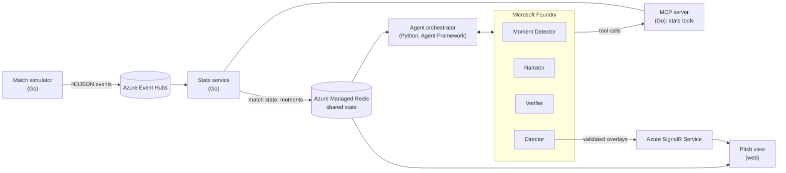
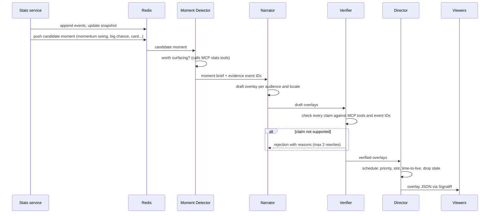

# 03 Architecture

Touchline is a streaming pipeline: synthetic events flow in one end, verified overlays flow out the other, and agents sit in the middle doing only what code cannot — deciding what matters and explaining it in words.

## Components

| Component | Language | Responsibility | Azure service |
| --- | --- | --- | --- |
| Match simulator | Go | Generates a deterministic synthetic match from a seed and scenario; replays at any speed | Container Apps job |
| Stats service | Go | Consumes events, runs the stats engine, writes match state and candidate moments to Redis | Container Apps |
| MCP server | Go | Exposes read-only stats tools so agents fetch numbers rather than invent them | Container Apps (same app as the stats service) |
| Agent orchestrator | Python | Runs the four agents per moment, manages handoffs, retries and timeouts | Container Apps; agents on Microsoft Foundry |
| Overlay publisher | Python | Validates overlays and pushes them to viewers | Azure SignalR Service |
| Pitch view | TypeScript | Draws the pitch, replays events, renders overlays per viewer profile | Container Apps (static) |

## Data flow for one moment

## Local mode and cloud mode

Every component reads and writes through small interfaces so the whole pipeline also runs on a laptop with no Azure account:

| Concern | Local mode | Cloud mode |
| --- | --- | --- |
| Event transport | stdin/stdout pipes (NDJSON) | Azure Event Hubs |
| Shared state | In-memory store | Azure Managed Redis |
| Overlay delivery | Server-sent events from the orchestrator | Azure SignalR Service |
| Agents | Foundry (needs credentials) or a recorded fixture for tests | Foundry |

Local mode keeps tests fast and lets judges run the data pipeline with nothing but Go installed.

## Latency budget

The target is an overlay on screen within **8 seconds** of the event that triggered it, at real-time playback.

| Step | Budget |
| --- | --- |
| Event to stats snapshot and candidate moment | 200 ms |
| Moment Detector | 1.5 s |
| Narrator (all audiences and locales in one call) | 3 s |
| Verifier | 1.5 s |
| Director and publish | 300 ms |
| Slack for one Verifier rewrite | 1.5 s |

The Director drops any overlay whose `show_at_ms` plus `ttl_ms` has already passed on the match clock. A late overlay is worse than none.

## Reliability

- **No evidence, no overlay.** `overlay.Validate` rejects anything without event IDs, so an unsupported claim cannot reach a screen even if an agent misbehaves.
- **Bounded retries.** The Verifier can send a draft back twice; after that the moment is dropped or the Director uses a template.
- **Timeouts with fallbacks.** Each agent call has a deadline. When one is missed, the Director publishes a template overlay built only from stats-engine numbers and marks it `fallback: true`.
- **Idempotent consumers.** Events carry a strictly increasing `seq`; consumers skip anything they have already applied, so a replayed Event Hubs partition does not double-count.
- **Deterministic replay.** The same seed and scenario give the same match, so any bug can be reproduced exactly.

## Security

- Managed identity for every Azure service connection; no keys in code or in the repository.
- The MCP server is read-only: agents can query statistics but cannot change match state.
- The pitch view receives overlays only; it holds no credentials.
- Secrets for local development live in a `.env` file that is git-ignored.

## Observability

- OpenTelemetry traces from the orchestrator, with one span per agent call and the moment ID as an attribute.
- Foundry tracing for model and tool calls.
- Application Insights for service logs and a small dashboard: overlays published, rejected, fallen back, and median time from event to screen.
- The pitch view's agent-trace panel reads the same data, which is also what the demo video shows.
